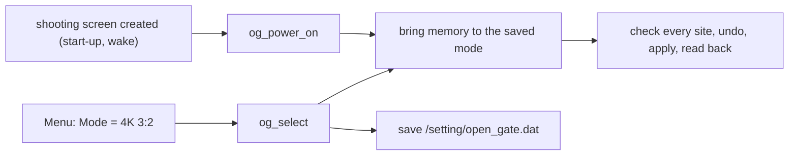

# Sony A7 IV custom firmware with open gate

Custom firmware for the Sony A7 IV (ILCE-7M4). It is
[Erlla's custom firmware v0.1.3](https://github.com/Erlla/sony-a7m4-custom-firmware) with one big addition:
**open gate**, 4K 3:2 and 5.7K 3:2 video from the whole sensor, switched on from the camera's own menu.

> [!CAUTION]
> **Experimental, unofficial firmware. Use entirely at your own risk.**
>
> - **Tested on one camera so far.** On an A7 IV set to NTSC and then to PAL, 4K 3:2 and 5.7K 3:2 apply from the menu
>   and record files at their full size.
> - Installing it can **permanently brick the camera**, cause boot loops or malfunctions, destroy photos, videos,
>   settings or calibration, and **void the warranty** or make Sony refuse repairs.
> - It is provided **"as is", with no warranty of any kind**. The authors and contributors **accept no responsibility
>   or liability** for any damage, loss or cost from using it. You alone are responsible for what you do with it.
> - **Not affiliated with, authorized or endorsed by Sony.**
>
> Read the full [disclaimer and limitation of liability](#disclaimer-and-limitation-of-liability) before downloading.
> If you don't accept it, don't use anything here.

> [!WARNING]
> **This is the `alpha-formats` branch: a test build, not for regular use.** File Format gains "4K 3:2 Open Gate" and
> "5.7K 3:2 Open Gate", which set the matching 4K format and frame rate and apply open gate with the switch on movie
> (with the crash guard from `alpha-movie`). It writes a step log to `/setting/og_diag.txt`. How it works:
> [open gate as File Format entries](methods/11-open-gate/FILE-FORMATS.md). For normal use, take beta from `main`.

[Features](#features) · [Download](#download) · [Install](#install) · [Using the features](#using-the-features) ·
[Limitations](#limitations) · [How open gate works](#how-open-gate-works) · [Build it yourself](#build-it-yourself) ·
[Disclaimer](#disclaimer-and-limitation-of-liability)

## Features

| Feature | What it does | Where | Source |
| --- | --- | --- | --- |
| [**Open gate**](#open-gate) | 4K 3:2 (3840x2560) and 5.7K 3:2 (5760x3840) video from the whole sensor | MENU > Shooting > Media > Open Gate | **New** |
| [**English LUT screens**](#custom-luts) | The Custom LUT screens in English instead of Chinese | Custom LUTs | **New, alpha only** |
| [Custom LUTs](#custom-luts) | 16 slots for imported looks, each with its own adjustments and strength | MENU > Exposure/Color > Color/Tone > Custom LUTs | v0.1.3 |
| [Custom aspect ratios](#custom-aspect-ratios) | 17:6, 65:24, 5:4, 7:6, 21:9 and 2.35:1 for stills | Aspect Ratio | v0.1.3 |
| [FL2 / FL3 Creative Looks](#fl2--fl3-creative-looks) | The FX2's FL2 and FL3 looks | Creative Look | v0.1.3 |
| [Third-party batteries](#automatic-features) | Shows their percentage, no more caution message | Automatic | v0.1.3 |
| [White balance tuning](#automatic-features) | Retuned AWB priority values | Automatic | v0.1.3 |
| [Lens AF filter](#automatic-features) | Keeps what third-party lenses report (untested) | Automatic | v0.1.3 |

**Removed from v0.1.3:** the custom shutter and focus sound menus. Their menu page became the Open Gate page.

## Download

There are two release channels. Pick one package; both install the same way.

| Channel | Release | What's in it | `BODYDATA.DAT` SHA-256 |
| --- | --- | --- | --- |
| **Beta** (recommended) | [`beta-0.1`](https://github.com/leogenot/sony-a7m4-custom-firmware-open-gate/releases/tag/beta-0.1) | Open gate and every v0.1.3 feature. Tested on a camera. Built from `main`. | `5ae4dc9e09d2f6eaee6ac84f3990dde2f7bdcd137a07d32341957d389b521a86` |
| **Alpha** | [`alpha-0.1`](https://github.com/leogenot/sony-a7m4-custom-firmware-open-gate/releases/tag/alpha-0.1) | Beta plus English LUT screens. **Not yet run on a camera.** Built from [`alpha`](https://github.com/leogenot/sony-a7m4-custom-firmware-open-gate/tree/alpha). | `52314214a75585b08534a458e53e10d1620dcf1b3c794801bc8d489f4e59ce50` |

You also need an install tool, one of:

- **Windows:** `M4_1.03_Windows_x64.zip` (Erlla's M4 Camera Tool) from Erlla's
  [v0.1.3 release](https://github.com/Erlla/sony-a7m4-custom-firmware/releases/tag/A7M4-ToolKit-v0.1.3).
- **Mac, Apple Silicon only:** `ZM4-release-v1.0.3.dmg` from
  [Hippasu/A7m4-Z4M-firmware-for-mac](https://github.com/Hippasu/A7m4-Z4M-firmware-for-mac/releases/latest). It is a
  third-party port of Erlla's tool and hasn't been tested with this build.

> [!IMPORTANT]
> **Check the SHA-256 of the `BODYDATA.DAT` you downloaded** against the table above, for example with
> `shasum -a 256 BODYDATA.DAT` (Mac) or `certutil -hashfile BODYDATA.DAT SHA256` (Windows). The package is signed with
> the [published key](keys/published/README.md) that v0.1.3's updater trusts, and anyone can sign with that key, so a
> valid signature proves nothing about who made a package.

Compared with v0.1.3, only two partitions change, plus their checksums: `nflasha15` (the main program `appFw.so` and
the 68 menu string banks) and `nflasha8` (`DmmCfg.bin`, 16 bytes).

## Install

This is the same route as Erlla's v0.1.3, with no Fastboot hardware needed. Erlla's
[full guide with screenshots](no-fastboot-install/README.en.md) covers it in more detail.

By installing, you confirm that you have read and accept the [disclaimer](#disclaimer-and-limitation-of-liability),
that you own the camera, and that you accept every risk, including losing the camera.

### Before you start

- [ ] The camera is an **ILCE-7M4 on official Sony firmware 6.02**, and it boots normally. Erlla reports successful
      installs on mainland China, Hong Kong, Japan and Canada-market cameras; other regions aren't guaranteed.
- [ ] You have **backed up** everything you care about from the camera and its cards.
- [ ] You have a **recovery plan**. Erlla recommends keeping Fastboot tools, a Multi-port flashing cable and an
      RP2040-Zero boot bridge at hand ([Fastboot maintenance](README.en.md#2-fastboot-modification-methods)). Without
      them, a failed install may not be recoverable.
- [ ] An **original Sony battery** is in the camera, charged enough for a firmware update.
- [ ] You have a **Windows PC** or an **Apple Silicon Mac** with the install tool from [Download](#download).
- [ ] Coming from v0.1.3 with a **custom shutter or focus sound** switched on? Switch it **off first**. The choice is
      saved in the camera, and this build has no menu to turn it off.

### Steps

1. **Put the package on the card.** Copy `BODYDATA.DAT` to the **root of the card in slot 1** (not in a folder) and
   put the card back in the camera.
2. **Connect the camera.** Turn it on, set **MENU > Setup > USB > USB Connection Mode** to **Mass Storage**, and
   connect it to the computer with USB.
3. **Patch the camera's updater.**
   - **Windows:** extract the M4 Camera Tool to a short path such as `D:\M4` and run `M4相机工具.exe`; approve the
     administrator prompt (the first run installs drivers and can take a while). Tick **相机已开机，USB 已连接，电量充足**
     (camera on, USB connected, battery charged) and click **写入补丁** (Write patch). The tool backs up the updater
     partition, patches it and reads it back. If it asks you to reconnect USB, keep the camera on and do so.
   - **Mac:** open the ZM4 `.dmg`, drag ZM4 to Applications and follow its steps. If macOS says the app is damaged, see
     the quarantine fix in [its README](https://github.com/Hippasu/A7m4-Z4M-firmware-for-mac#mac常见问题). ZM4's
     release also ships a `BODYDATA.DAT`: that one is Erlla's plain v0.1.3 (SHA-256 `cfb79295…`), without open gate.
     Make sure the card holds **this project's** `BODYDATA.DAT`.
4. **Run the update on the camera.** When the tool says **可以拔下 USB 开始更新** (you can unplug USB and start the
   update), unplug the cable with the camera still on. Go back to the shooting screen and open **Version / Software
   Update** in the camera's menu. Check the target version: Erlla's guide shows 6.02 -> 6.01, the custom firmware's
   label. Choose **执行** (Execute) and wait for the camera to restart. Start within the time the tool shows, about
   10 minutes.

   > [!WARNING]
   > Once the update starts, **don't turn the camera off or take the card out**, even if the tool's countdown runs out.

5. **Check and finish.** After the restart, check that the camera shoots, saves and plays back. Reconnect USB and click
   **更新已结束** (update finished), then **恢复普通 USB** (restore normal USB) to get the camera's normal USB
   connection back.

**Going back to official firmware:** install a newer official Sony package with Sony's own update procedure; see
[Restore official firmware](no-fastboot-install/README.en.md) in Erlla's guide.

## Using the features

### Open gate

**MENU > Shooting > Media > Open Gate > Mode:** **Off**, **4K 3:2** (3840x2560) or **5.7K 3:2** (5760x3840).

1. Turn the Still/Movie/S&Q switch to **stills**. On movie, Mode says "This function is currently disabled".
2. Choose a mode and confirm. It applies straight away and is saved in the camera; no USB or restart needed.
3. Switch to **movie** and record. The mode stays saved until you set it to Off. After a battery pull it is applied
   again the next time the switch is on stills (see [Limitations](#limitations)).

Use these recording settings while a mode is on:

| Camera set to | File format | Frame rate | Also |
| --- | --- | --- | --- |
| NTSC | XAVC HS 4K or XAVC S 4K | 24p | Full frame, Proxy Recording Off |
| PAL | XAVC S 4K | 25p | Full frame, Proxy Recording Off |

Other formats and frame rates don't work while a mode is on. The camera's NTSC/PAL setting is detected automatically.

Good to know:
- **5.7K uses about 300 Mbps** on the 100M settings. The menu still says 100M, so the card fills about three times
  faster than shown. Use a fast card (CFexpress Type A, or SD V60/V90).
- **Files open at 3:2 directly** in editors such as DaVinci Resolve, with no remux. Sony's own XML inside the file
  still says 3840x2160.
- 5.7K uses I and P pictures only, so there are no duplicated (held) frames.
- The camera plays back 4K 3:2 files, but not 5.7K.
- The rear screen shows the whole 3:2 picture with focus frames. There's no de-squeeze preview.
- **Off** puts everything back to stock straight away.
- If a mode can't be applied, the menu shows no error; Mode keeps showing what is really in place.

### Custom LUTs

**MENU > Exposure/Color > Color/Tone > Custom LUTs:** 16 slots for imported looks, each with eight adjustments plus
strength.

1. Download looks as camera JSON files from [M4 Color Lab](https://erlla.github.io/sony-a7m4-custom-firmware/) and put
   them in `PRIVATE/M4ROOT/GENERAL/LUT/` on the card (at most 128 KiB per file, 256 files in the folder).
2. Open Custom LUTs and press **Left** to import: choose the card and the file, then follow the on-camera steps.
3. Select a look with the keys or by touching the number column on the left. Press **Right** for the editor:
   Left/Right picks a control, Up/Down changes it. Confirm saves; Cancel goes back.

- Imported looks stay in the camera, so the card isn't needed afterwards. The first use after power-on takes about a
  second to load.
- `.cube` and DCP files must be converted to the JSON format first; renaming isn't enough
  ([format](methods/08-custom-lut/README.en.md)).
- **On beta**, these screens are in Chinese, and cameras without a Chinese font show empty boxes.
- **On alpha**, they are in English whatever the camera language: card and file selection, delete confirmations, the
  adjustments, status and errors. The words are
  [Erlla's English labels](https://github.com/Erlla/sony-a7m4-custom-firmware/blob/main/methods/08-custom-lut/UI-LANGUAGES.en.md)
  plus 16 more for status and error lines they don't cover ([list](https://github.com/leogenot/sony-a7m4-custom-firmware-open-gate/blob/alpha/native/open-gate/lut_labels.json)). A look you
  named exactly like one of the Chinese labels also shows in English. Long English lines haven't been checked on the
  camera's screen yet and may be cut off.

### Custom aspect ratios

**Aspect Ratio** (camera menu or Fn menu) adds **17:6, 65:24, 5:4, 7:6, 21:9 and 2.35:1** after the stock options.

1. Choose a ratio and confirm, then compose inside the mask in the shooting view. The mask follows the camera's
   rotation.
2. JPEG and HEIF are cropped to the ratio. RAW keeps the full sensor area; in RAW+JPEG the JPEG is cropped.
3. Automatic review and the in-camera album show the cropped photo, and magnified playback works on custom-ratio JPEG
   and RAW+JPEG.

Some settings pages briefly show the plain 3:2 preview; the mask comes back in the shooting view.

### FL2 / FL3 Creative Looks

**MENU > Exposure/Color > Color/Tone > Creative Look** includes **FL2** and **FL3**, ported from the FX2.

- New RAW files carry both looks, so Imaging Edge Edit can switch to FL2 or FL3 from the original ARW.
- Colours closely match Imaging Edge's re-selected FL2/FL3 (mean ΔE76 about 1.0); they aren't pixel-identical to a
  real FX2.

### Automatic features

These work on their own, with no menu:

- **Third-party batteries:** the battery percentage shows for batteries that report it, and the "continue using a
  third-party battery" caution no longer appears. Charging and temperature protection are unchanged. **Firmware
  updates still need an original Sony battery.**
- **White balance tuning:** the existing AWB priority setting uses **Ambience** −1, **Standard** 0, **White** 97 (the
  FX2's factory White is 88). Manual colour temperature is unchanged.
- **Third-party lens AF filter:** keeps the capabilities and speed profiles the lens reports instead of filtering them
  by lens ID. **Untested on hardware:** no faster focus is promised for any lens.

## Limitations

- **Tested on one camera**, set to NTSC and to PAL. Alpha's English LUT screens haven't been run on a camera yet.
- **Open gate is chosen with the switch on stills.** It stays on in movie mode, but you can't change it there.
- **After a battery pull, open gate comes back on its own only once you visit stills.** If the camera starts with the
  switch on movie, switch to stills once.
- **Open gate only works in the recording settings above.** No 1080p open gate yet (see the
  [research notes](methods/11-open-gate/HD-RESEARCH.md)), no de-squeeze preview, and no in-camera playback of 5.7K.
- **The custom shutter and focus sounds are gone.** Their code is still in the firmware, but no menu reaches it.

## How open gate works

The open-gate changes come from [ArcaneLantern/a7iv-open-gate-test](https://github.com/ArcaneLantern/a7iv-open-gate-test)
(at `2f2a021`), a USB kit that writes them into camera memory for one power-on. This firmware does the same writes from
inside the camera, so no USB session or cold boot is needed and the mode survives power-offs.



- **Where.** No image-processing file changes on disk. A small native module, placed in an empty gap of `appFw.so`,
  writes into memory at run time: the coprocessor's sensor read-out and output size, a stored drive-parameter record,
  the encoder's tables in `av-cam.bin` and the MP4 writer in `libmpr.so`. The kit's first step, a taller raw write
  buffer, is written into `DmmCfg.bin` at build time instead, so the kit's cold-boot rule goes away.
- **What.** Every address and byte comes from the kit's design files, pinned by SHA-256 in
  [`layout.json`](native/open-gate/layout.json). The build compiles them into four presets: 4K and 5.7K, each for NTSC
  and PAL. Nothing is typed into C by hand.
- **When.** It runs each time the shooting screen is created and when you confirm the menu, with the switch on stills.
- **Safety.** Before writing, it checks that every site holds either the stock bytes or one preset's bytes; anything
  else and nothing is written. It reads back every write and puts everything back on any failure. The NTSC/PAL setting
  is read from the camera's stored records, and a camera that doesn't match exactly one of them is left untouched.
- **Menu.** The Open Gate page is the custom firmware's Custom Shutter Sound page, taken over: renamed, moved to
  Shooting > Media, with one setting whose callbacks go into the module. No Sony string changes.

Details: [the open-gate method](methods/11-open-gate/README.en.md) ·
[the module, records, hooks and relocations](native/open-gate/README.md).

## Build it yourself

The build is reproducible: the same inputs give the same `BODYDATA.DAT`, byte for byte.

You need:
- Erlla's v0.1.3 [`BODYDATA.DAT`](https://github.com/Erlla/sony-a7m4-custom-firmware/releases/download/A7M4-ToolKit-v0.1.3/BODYDATA.DAT),
  SHA-256 `cfb7929594f3f0a770b9fbecaff1269cd945bc0932e3ddbabf73050f8eda475f`;
- the kit's `windows/tools/modding/designs` folder from
  [ArcaneLantern/a7iv-open-gate-test](https://github.com/ArcaneLantern/a7iv-open-gate-test) at `2f2a021`;
- [Zig 0.15.2](https://ziglang.org/download/) (the official build; the binary's hash is pinned);
- Python 3.11 or newer.

```sh
python3 -m venv .venv
.venv/bin/pip install -e ".[firmware,test]"
.venv/bin/python -m a7m4.open_gate build --base BODYDATA-custom-v0.1.3.DAT \
    --designs <kit>/windows/tools/modding/designs --zig <zig-0.15.2>/zig \
    --private-key keys/published/A7M4_updater_private.pem \
    --public-key keys/published/A7M4_updater_public.pem --output out/open-gate
```

Check out `main` for the beta build or `alpha` for the alpha build. The output folder gets `BODYDATA.DAT` and
`verification.json`, which lists every input and output hash, the changed files and byte ranges, the signature check
and the package audit. Any input that doesn't match its pinned hash stops the build.

Offline checks: `python -m pytest tests/test_open_gate.py`. Set `OG_DESIGNS` and `OG_V013_DEV` (an unpacked v0.1.3
`0700_part_image/dev` tree) if they aren't at the workspace defaults.

### What's in this repo

| Path | What |
| --- | --- |
| [`methods/11-open-gate/`](methods/11-open-gate/README.en.md) | The open-gate method: modes, menu, build, limits, and [research notes on 1080p open gate](methods/11-open-gate/HD-RESEARCH.md) |
| [`native/open-gate/`](native/open-gate/README.md) | The module's C and assembly, `layout.json` (every pinned input, address and hook) and `stored_record.json` |
| `a7m4/open_gate.py`, `a7m4/open_gate_sites.py` | The build: presets, module link, `appFw.so` and string bank edits, packaging |
| `tests/test_open_gate.py`, `tests/native/` | The offline checks |
| [`methods/00` to `10`](README.en.md#2-fastboot-modification-methods) | Erlla's methods: SD recovery, signing, version, FL2/FL3, batteries, lens AF, sounds, aspect ratios, LUTs, shell, white balance |
| [`no-fastboot-install/`](no-fastboot-install/README.en.md) | Erlla's install route and the M4 Camera Tool's source |
| [`keys/published/`](keys/published/README.md) | The published signing key pair |

Erlla's original README: [English](README.en.md) · [中文](README.zh-CN.md)

## Disclaimer and limitation of liability

**Read this before downloading, building or installing anything from this repository or its releases.**

1. **No warranty.** This firmware, its source, its build tools, its packages and its documentation (together, "the
   software") are provided **"as is" and "as available", without warranty of any kind**, express or implied,
   including but not limited to warranties of merchantability, fitness for a particular purpose, non-infringement,
   accuracy, reliability or that it will work on your camera. This repeats and does not limit sections 15 and 16 of
   the [GPL-3.0](LICENSE).
2. **No liability.** To the maximum extent permitted by applicable law, **the authors, contributors, maintainers and
   anyone who conveys the software are not liable for any damage, loss or cost of any kind**: a bricked, damaged or
   malfunctioning camera, lens, battery, card or computer; lost or corrupted photos, videos, settings or calibration;
   repair, replacement or recovery costs; voided warranty or refused service; missed shoots, lost income, business
   interruption, or any direct, indirect, incidental, special, consequential or punitive damages, however caused and
   on any theory of liability, even if advised of the possibility of such damage.
3. **Your risk, your responsibility.** You use the software entirely at your own risk and are solely responsible for
   your decision to use it, for following the instructions correctly, for backing up your camera and data, and for any
   consequence. If it fails, you bear the whole cost of any servicing, repair or correction.
4. **Experimental and barely tested.** This build has been run on one camera, set to NTSC and PAL. It changes how the
   camera's processors, encoder and file writer work, outside what Sony designed and tested. Behaviour may be wrong or
   unsafe, including overheating, freezes, corrupted or unplayable recordings and failed boots. Don't rely on it for
   paid, important or unrepeatable work.
5. **Not Sony.** This project is independent. It is not affiliated with, authorized, sponsored or endorsed by Sony
   Group Corporation or any of its subsidiaries. Sony, Alpha, α, XAVC, XAVC S, XAVC HS and other names are trademarks
   of their owners and are used only to describe compatibility. Sony doesn't support this firmware: don't contact Sony
   about problems it causes. Installing it is likely to void your warranty.
6. **Legality is up to you.** Only modify equipment you lawfully own or are explicitly allowed to modify. You are
   responsible for complying with the laws, regulations and agreements that apply to you, including any about
   modifying firmware, warranties, radio or recording equipment.
7. **No support, no obligation.** There is no obligation to provide support, updates, fixes or recovery help, and no
   paid service is offered or authorized. Anyone charging for flashing or support does so on their own account.
8. **Third-party work.** The software builds on third-party projects (listed below) under their own licenses. Their
   authors are not responsible for this build, and this project is not responsible for theirs.
9. **The published signing key gives no assurance.** Packages are signed with a key whose private half is public.
   A valid signature proves nothing about who made a package or whether it is safe. Only install a package whose
   SHA-256 you have checked, or one you built and reviewed yourself.
10. **Acceptance.** By downloading, building, installing or using the software, you confirm that you have read,
    understood and accepted this disclaimer. If you don't accept it, don't use the software.

If any part of this disclaimer is held unenforceable, the rest still applies, and the limitation applies to the
fullest extent the law allows.

## Credits and licenses

- Custom firmware v0.1.3, the install tool, the build tooling and the aspect-ratio hooks this module chains onto:
  [Erlla/sony-a7m4-custom-firmware](https://github.com/Erlla/sony-a7m4-custom-firmware), GPL-3.0. Erlla's README lists
  the research it builds on.
- Open-gate designs, methods and constants:
  [ArcaneLantern/a7iv-open-gate-test](https://github.com/ArcaneLantern/a7iv-open-gate-test), GPL-3.0.
- English LUT labels: Erlla's [UI language resources](https://github.com/Erlla/sony-a7m4-custom-firmware/blob/main/methods/08-custom-lut/UI-LANGUAGES.en.md), GPL-3.0.
- This repository is GPL-3.0-only ([license](LICENSE)); material published under MIT before Erlla's license change
  keeps that grant ([MIT](LICENSE-MIT-LEGACY)).
- Sony firmware isn't included; get it from Sony or the releases above.
