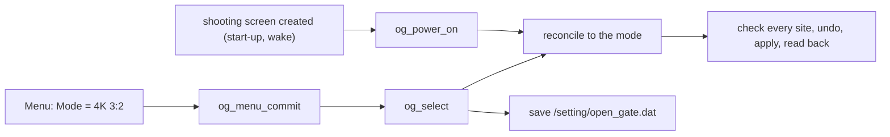

# Sony A7 IV custom firmware with open gate

[Erlla's custom firmware v0.1.3](https://github.com/Erlla/sony-a7m4-custom-firmware) for the Sony A7 IV (ILCE-7M4),
with **open gate** added: 4K 3:2 and 5.7K 3:2 video from the whole sensor, set from the camera's menu. The **custom
LUTs** and every other v0.1.3 feature stay. The **custom shutter and focus sound menus** are removed: their page
became the Open Gate page.

> [!CAUTION]
> **Experimental, unofficial firmware. Use entirely at your own risk.**
>
> - **Not yet run on a camera.** This build has been checked offline only: tests, reproducible builds and a package
>   audit.
> - Installing it can **permanently brick the camera**, cause boot loops or malfunctions, destroy photos, videos,
>   settings or calibration, and **void the warranty** or make Sony refuse repairs.
> - It is provided **"as is", with no warranty of any kind**. The authors and contributors **accept no responsibility
>   or liability** for any damage, loss or cost from using it. You alone are responsible for what you do with it.
> - **Not affiliated with, authorized or endorsed by Sony.**
>
> Read the full [disclaimer and limitation of liability](#disclaimer-and-limitation-of-liability) before downloading.
> If you don't accept it, don't use anything here.

[Download](#download) · [Install](#install) · [Features and how to use them](#features-and-how-to-use-them) ·
[How open gate works](#how-open-gate-works) · [Build it yourself](#build-it-yourself) · [What's in this repo](#whats-in-this-repo) ·
[Disclaimer](#disclaimer-and-limitation-of-liability)

Erlla's original README: [English](README.en.md) · [中文](README.zh-CN.md)

## Download

| What | Where |
| --- | --- |
| The installable package | `BODYDATA.DAT` on the release [`v0.1.3-open-gate.3`](https://github.com/leogenot/sony-a7m4-custom-firmware-open-gate/releases/tag/v0.1.3-open-gate.3), SHA-256 `39eaf08036e9b2e39b532623f10ead9c358825b560276e9f151f1bc6e215c283` |
| The same build, unbundled | [sony-a7m4-open-gate-firmware](https://github.com/leogenot/sony-a7m4-open-gate-firmware): the 70 changed files and a script that bundles them into v0.1.3's package |
| The install tool | `M4_1.03_Windows_x64.zip` from Erlla's [v0.1.3 release](https://github.com/Erlla/sony-a7m4-custom-firmware/releases/tag/A7M4-ToolKit-v0.1.3) |
| The install tool on a Mac | `ZM4-release-v1.0.3.dmg` from [Hippasu/A7m4-Z4M-firmware-for-mac](https://github.com/Hippasu/A7m4-Z4M-firmware-for-mac/releases/latest) (third party, Apple Silicon only) |

Compared with v0.1.3, only two partitions change, plus their checksums: `nflasha15` (the camera's main program
`appFw.so` and the 68 menu string banks) and `nflasha8` (`DmmCfg.bin`, 16 bytes). It is signed with the
[published key](keys/published/README.md) v0.1.3's updater trusts. Anyone can sign with that key, so a valid signature
proves nothing about who made a package: check the SHA-256 above.

## Install

Same route as Erlla's v0.1.3, without Fastboot hardware
([Erlla's full guide with screenshots](no-fastboot-install/README.en.md)).

By installing, you confirm you have read and accept the [disclaimer](#disclaimer-and-limitation-of-liability), that
you own the camera, and that you accept every risk, including losing the camera.

**Before you start**
- Back up everything you care about from the camera and its cards. Have a recovery plan: Erlla recommends keeping
  Fastboot tools, a Multi-port flashing cable and an RP2040-Zero boot bridge at hand
  ([Fastboot maintenance](README.en.md#2-fastboot-modification-methods)); without them, a failed install may not be
  recoverable.
- The camera must be an ILCE-7M4 on **official Sony firmware 6.02** and must boot normally. Erlla reports successful
  installs on mainland China, Hong Kong, Japan and Canada-market cameras; other regions aren't guaranteed.
- Use an **original Sony battery**, charged enough for a firmware update, and keep the power stable.
- You need a **Windows PC** for Erlla's M4 Camera Tool, or an **Apple Silicon Mac** for ZM4 (see below).
- If the camera runs v0.1.3 and you switched on a **custom shutter or focus sound**, switch it off **before**
  installing. The choice is saved in the camera, and this build has no menu to turn it off.

**On a Mac (Apple Silicon only):** [ZM4](https://github.com/Hippasu/A7m4-Z4M-firmware-for-mac), a third-party macOS
port of Erlla's tool, does the same updater patch. Download `ZM4-release-v1.0.3.dmg` from its
[latest release](https://github.com/Hippasu/A7m4-Z4M-firmware-for-mac/releases/latest), drag ZM4 to Applications and follow
its steps instead of steps 2 and 3 below; the update on the camera (step 4) is the same. Its release also ships a
`BODYDATA.DAT`: that one is Erlla's v0.1.3 itself (SHA-256 `cfb79295…`), without open gate, so put **this build's**
`BODYDATA.DAT` on the card. If macOS
says the app is damaged, see the quarantine fix in [its README](https://github.com/Hippasu/A7m4-Z4M-firmware-for-mac#mac常见问题).
ZM4 isn't part of this project and hasn't been tested with this build.

**Steps**
1. Copy `BODYDATA.DAT` to the **root of the card in slot 1**, not in a folder, and put the card in the camera.
2. Extract the M4 Camera Tool to a short path such as `D:\M4`. Turn the camera on, set **MENU > Setup > USB > USB
   Connection Mode** to **Mass Storage**, and connect it to the PC. Run `M4相机工具.exe` and approve the administrator
   prompt. The first run installs drivers and can take a while.
3. Tick **相机已开机，USB 已连接，电量充足** (camera on, USB connected, battery charged) and click **写入补丁** (Write
   patch). The tool backs up and patches the camera's updater partition, then reads it back. If it asks you to
   reconnect USB, keep the camera on and do so.
4. When it shows **可以拔下 USB 开始更新** (you can unplug USB and start the update), unplug the cable with the camera
   still on, go back to the shooting screen, and open **Version / Software Update** in the camera's menu. Check the
   target version (Erlla's guide shows 6.02 -> custom 6.01, the custom firmware's label), choose **执行** (Execute),
   and wait for the camera to restart. Start within the time the tool shows, about 10 minutes. **Once the update
   starts, don't turn the camera off or take the card out, even if the tool's countdown runs out.**
5. After the restart, check that the camera shoots, saves and plays back. Reconnect USB and click **更新已结束** (update
   finished). Click **恢复普通 USB** (restore normal USB) to get the camera's normal USB connection back.

**Going back to official firmware:** install a newer official Sony package with Sony's own update procedure; see
[Restore official firmware](no-fastboot-install/README.en.md) in Erlla's guide.

## Features and how to use them

### Open gate (new): 3:2 full-sensor video

**MENU > Shooting > Media > Open Gate > Mode**: **Off**, **4K 3:2** (3840x2560) or **5.7K 3:2** (5760x3840).

1. Turn the Still/Movie/S&Q switch to **stills**. With it on movie, Mode shows "This function is currently disabled".
2. Pick a mode and confirm. It applies at once, with no USB and no power cycle, and is saved in the camera.
3. Turn the dial to movie and record. The mode stays on after a power-off or a battery pull until you set it to Off.

- Record in **XAVC HS 4K or XAVC S 4K at 24p** on NTSC cameras, or **XAVC S 4K at 25p** on PAL cameras, full frame.
  Other formats and frame rates don't work while a mode is on.
- Set **Proxy Recording** to Off.
- 5.7K records at about 300 Mbps on the 100M settings. The menu still says 100M, so the card fills about three times
  faster than shown. Use a fast card (CFexpress Type A, or SD V60/V90).
- Files open at 3:2 in editors such as DaVinci Resolve without a remux: the MP4 headers state 3840x2560 or 5760x3840.
  Sony's own XML inside the file still says 3840x2160.
- 5.7K is coded with I and P pictures only, which removes the duplicate (held) frames. The camera plays 4K 3:2 files
  back, but not 5.7K.
- The rear screen shows the whole 3:2 picture with focus frames. There's no de-squeeze preview.
- **Off** puts every change back to stock straight away.
- If a mode can't be applied (another apply running, the coprocessor not ready, unexpected bytes, a read or write
  error), the menu shows no error: Mode keeps showing what is really in place.

### Custom LUTs

**MENU > Exposure/Color > Color/Tone > Custom LUTs**: 16 slots for imported looks, each with eight adjustments plus
strength.

1. Download looks as camera JSON files from [M4 Color Lab](https://erlla.github.io/sony-a7m4-custom-firmware/) and put
   them in `PRIVATE/M4ROOT/GENERAL/LUT/` on the card (each file 128 KiB at most, at most 256 files in the folder).
2. Open Custom LUTs and press **Left** to import: choose the card and the file, then follow the on-camera steps.
3. Select a look with the keys or by touching the number column on the left. Press **Right** for the editor:
   Left/Right picks a control, Up/Down changes it. Confirm saves; Cancel goes back.

- Imported looks stay in the camera, so the card isn't needed afterwards. The first use after power-on takes about a
  second to load.
- `.cube` and DCP files must be converted to the JSON format first; renaming isn't enough
  ([format](methods/08-custom-lut/README.en.md)).

### Custom aspect ratios

**Aspect Ratio** (camera menu or Fn menu) adds **17:6, 65:24, 5:4, 7:6, 21:9 and 2.35:1** after the stock options.

1. Choose a ratio and confirm, then compose inside the mask in the shooting view. The mask follows the camera's
   rotation.
2. JPEG and HEIF are cropped to the ratio. RAW keeps the full sensor area; in RAW+JPEG the JPEG is cropped.
3. Automatic review and the in-camera album show the cropped photo, and magnified playback works on custom-ratio
   JPEG and RAW+JPEG.

- Some settings pages briefly show the plain 3:2 preview; the mask comes back in the shooting view.

### FL2 / FL3 Creative Looks

**MENU > Exposure/Color > Color/Tone > Creative Look** includes **FL2** and **FL3**, ported from the FX2.

- New RAW files carry both looks, so Imaging Edge Edit can switch to FL2 or FL3 from the original ARW.
- Colours closely match Imaging Edge's re-selected FL2/FL3 (mean ΔE76 about 1.0); they aren't pixel-identical to a
  real FX2.

### Third-party batteries

Automatic. The battery percentage shows for third-party batteries that report it, and the "continue using a
third-party battery" caution no longer appears. Charging and temperature protection are unchanged. **Firmware updates
still need an original Sony battery.**

### White balance tuning

Automatic, in the existing AWB priority setting: **Ambience** −1, **Standard** 0, **White** 97 (the FX2's factory
White is 88). No new menu; manual colour temperature is unchanged.

### Third-party lens AF capability filter

Automatic. Keeps the capabilities and speed profiles the lens reports instead of filtering them by lens ID.
**Untested on hardware:** no faster focus is promised for any lens.

### Removed from v0.1.3

- **Custom shutter and focus sounds:** their menus are gone, because the Open Gate page took the Custom Shutter Sound
  page's place. The sound code is still in the firmware, but nothing reaches it.

## How open gate works

The open-gate changes come from [ArcaneLantern/a7iv-open-gate-test](https://github.com/ArcaneLantern/a7iv-open-gate-test)
(at `2f2a021`), a USB kit that writes them into camera memory for one power-on. This build does the same writes from
inside the camera, so no USB session or cold boot is needed and the mode survives power-offs.



**Where the changes go.** Nothing in Sony's image-processing files changes on disk. A native module, linked into an
existing empty gap of `appFw.so`, writes into memory at run time:

| Target | What changes | How it is written |
| --- | --- | --- |
| Coprocessor RAM | The full-height sensor read-out, the output size, the rear-screen 3:2 fill | `sen_dma_transfer` through a 4 KB DMA buffer, whole 64-byte lines, read back after each write |
| Stored drive-parameter record | 26 bytes of the drive mode the kit uses (`0x8c0` on NTSC cameras, `0x880` on PAL) | The same DMA path, found through its pointer chain |
| `av-cam.bin` tables | The encoder: memory blocks, descriptors, profiles, bit rates, no B pictures for 5.7K | A `/dev/mem` mapping, checked through `pread` of `/dev/mem` too |
| `libmpr.so` | The MP4 writer: picture size, header sizes, edit-list start | `/proc/self/mem` (data and instructions) |

The kit's first step, a taller raw write buffer, is written into `DmmCfg.bin` at build time instead, so it is always
on and the kit's cold-boot rule goes away.

**Where the bytes come from.** Every address and byte comes from the kit's design files, pinned by SHA-256 in
[`layout.json`](native/open-gate/layout.json), plus the stored-record bytes in
[`stored_record.json`](native/open-gate/stored_record.json). The build compiles them into a site image inside the
module: four presets (4K and 5.7K, each for NTSC and PAL). Nothing is typed into C.

**When it runs.** Two hooks on the shooting screen's creation (`0x1ddab68`, `0x1e56b2c`) call the custom firmware's
aspect-ratio code first, unchanged, then `og_power_on`, which brings memory to the saved mode. Confirming the menu calls
`og_select`, which does the same right away and then saves the mode. Both only act with the dial on stills, as the
kit does; with the dial on movie the next shooting screen retries.

**How it stays safe.** Each apply first reads every site of the camera's NTSC/PAL family. Every site must hold either
its stock bytes or one preset's bytes; anything else and nothing is written. Then it undoes the other preset, applies
the chosen one in the kit's order and reads each write back. On any failure it puts every touched site back. Off puts
every site back to stock. The camera's NTSC/PAL setting is detected from its stored records: exactly one of the two
drive modes' records must hold the kit's bytes (on an NTSC camera, `0x880`'s record differs from the kit's PAL stock),
and a camera that matches neither or both is left untouched.

**The menu.** The setting is the custom firmware's own Custom Shutter Sound page, taken over: its page, controller and
ids already work on the camera, so nothing new is registered. The page is renamed Open Gate and listed on Shooting >
Media, holds only the Mode setting, and that setting gets a third option and callbacks into the module. Eight existing
relocations change in place, so `.rela.dyn` keeps its size. The four texts are the page's own, rewritten in place in
all 68 string banks; no Sony string changes. An earlier version added a new item of its own; on the camera it had no
title and couldn't be selected (its "selectable" answers were inverted), which is why this one reuses a working page.

Details: [the open-gate method](methods/11-open-gate/README.en.md) · [the module, records, hooks and relocations](native/open-gate/README.md).

**Later work:** 1080p open gate (1920x1280) looks possible at 24/25/30p but isn't built; see the
[research notes](methods/11-open-gate/HD-RESEARCH.md) for what it would take and the camera check that decides it.

## Build it yourself

The build is reproducible: the same inputs give the same `BODYDATA.DAT`, byte for byte.

You need:
- Erlla's v0.1.3 [`BODYDATA.DAT`](https://github.com/Erlla/sony-a7m4-custom-firmware/releases/download/A7M4-ToolKit-v0.1.3/BODYDATA.DAT),
  SHA-256 `cfb7929594f3f0a770b9fbecaff1269cd945bc0932e3ddbabf73050f8eda475f`;
- the kit's `windows/tools/modding/designs` folder from
  [ArcaneLantern/a7iv-open-gate-test](https://github.com/ArcaneLantern/a7iv-open-gate-test) at `2f2a021`;
- [Zig 0.15.2](https://ziglang.org/download/) (the official build; the binary's hash is pinned);
- Python 3.11 or newer.

```sh
python3 -m venv .venv
.venv/bin/pip install -e ".[firmware,test]"
.venv/bin/python -m a7m4.open_gate build --base BODYDATA-custom-v0.1.3.DAT \
    --designs <kit>/windows/tools/modding/designs --zig <zig-0.15.2>/zig \
    --private-key keys/published/A7M4_updater_private.pem \
    --public-key keys/published/A7M4_updater_public.pem --output out/open-gate
```

The output folder gets `BODYDATA.DAT` and `verification.json`: every input and output hash, the changed files and
byte ranges, the module's symbols, the signature check and the package audit. Any input that doesn't match its pinned
hash stops the build.

Offline checks: `python -m pytest tests/test_open_gate.py`. They test the site image against the designs and v0.1.3's
files, run the module's C code on the host against fake memory, and check the composed `appFw.so` and all 68 string
banks. Set `OG_DESIGNS` and `OG_V013_DEV` (an unpacked v0.1.3 `0700_part_image/dev` tree) if they aren't at the
workspace defaults.

## What's in this repo

| Path | What |
| --- | --- |
| [`methods/11-open-gate/`](methods/11-open-gate/README.en.md) | The open-gate method: modes, menu, build, limits; [research notes on 1080p open gate](methods/11-open-gate/HD-RESEARCH.md) for later work |
| [`native/open-gate/`](native/open-gate/README.md) | The module's C and assembly, `layout.json` (every pinned input, address and hook) and `stored_record.json` |
| `a7m4/open_gate.py`, `a7m4/open_gate_sites.py` | The build: site image, module link, `appFw.so` and string bank edits, packaging |
| `tests/test_open_gate.py`, `tests/native/` | The offline checks |
| [`methods/00` to `10`](README.en.md#2-fastboot-modification-methods) | Erlla's methods: SD recovery, signing, version, FL2/FL3, batteries, lens AF, sounds, aspect ratios, LUTs, shell, white balance |
| [`no-fastboot-install/`](no-fastboot-install/README.en.md) | Erlla's install route and the M4 Camera Tool's source |
| [`keys/published/`](keys/published/README.md) | The published signing key pair |

## Disclaimer and limitation of liability

**Read this before downloading, building or installing anything from this repository or its releases.**

1. **No warranty.** This firmware, its source, its build tools, its packages and its documentation (together, "the
   software") are provided **"as is" and "as available", without warranty of any kind**, express or implied,
   including but not limited to warranties of merchantability, fitness for a particular purpose, non-infringement,
   accuracy, reliability or that it will work on your camera. This repeats and does not limit sections 15 and 16 of
   the [GPL-3.0](LICENSE).
2. **No liability.** To the maximum extent permitted by applicable law, **the authors, contributors, maintainers and
   anyone who conveys the software are not liable for any damage, loss or cost of any kind**: a bricked, damaged or
   malfunctioning camera, lens, battery, card or computer; lost or corrupted photos, videos, settings or calibration;
   repair, replacement or recovery costs; voided warranty or refused service; missed shoots, lost income, business
   interruption, or any direct, indirect, incidental, special, consequential or punitive damages, however caused and
   on any theory of liability, even if advised of the possibility of such damage.
3. **Your risk, your responsibility.** You use the software entirely at your own risk and are solely responsible for
   your decision to use it, for following the instructions correctly, for backing up your camera and data, and for any
   consequence. If it fails, you bear the whole cost of any servicing, repair or correction.
4. **Experimental and untested.** This build has not been run on a camera. It changes how the camera's processors,
   encoder and file writer work, outside what Sony designed and tested. Behaviour may be wrong or unsafe, including
   overheating, freezes, corrupted or unplayable recordings and failed boots. Don't rely on it for paid, important or
   unrepeatable work.
5. **Not Sony.** This project is independent. It is not affiliated with, authorized, sponsored or endorsed by Sony
   Group Corporation or any of its subsidiaries. Sony, Alpha, α, XAVC, XAVC S, XAVC HS and other names are trademarks
   of their owners and are used only to describe compatibility. Sony doesn't support this firmware: don't contact Sony
   about problems it causes. Installing it is likely to void your warranty.
6. **Legality is up to you.** Only modify equipment you lawfully own or are explicitly allowed to modify. You are
   responsible for complying with the laws, regulations and agreements that apply to you, including any about
   modifying firmware, warranties, radio or recording equipment.
7. **No support, no obligation.** There is no obligation to provide support, updates, fixes or recovery help, and no
   paid service is offered or authorized. Anyone charging for flashing or support does so on their own account.
8. **Third-party work.** The software builds on third-party projects (listed below) under their own licenses. Their
   authors are not responsible for this build, and this project is not responsible for theirs.
9. **The published signing key gives no assurance.** Packages are signed with a key whose private half is public.
   A valid signature proves nothing about who made a package or whether it is safe. Only install a package whose
   SHA-256 you have checked, or one you built and reviewed yourself.
10. **Acceptance.** By downloading, building, installing or using the software, you confirm that you have read,
    understood and accepted this disclaimer. If you don't accept it, don't use the software.

If any part of this disclaimer is held unenforceable, the rest still applies, and the limitation applies to the
fullest extent the law allows.

## Credits and licenses

- Custom firmware v0.1.3, the install tool, the build tooling and the aspect-ratio hooks this module chains onto:
  [Erlla/sony-a7m4-custom-firmware](https://github.com/Erlla/sony-a7m4-custom-firmware), GPL-3.0. Erlla's README lists
  the research it builds on.
- Open-gate designs, methods and constants:
  [ArcaneLantern/a7iv-open-gate-test](https://github.com/ArcaneLantern/a7iv-open-gate-test), GPL-3.0.
- This repository is GPL-3.0-only ([license](LICENSE)); material published under MIT before Erlla's license change
  keeps that grant ([MIT](LICENSE-MIT-LEGACY)).
- Sony firmware isn't included; get it from Sony or the releases above.
